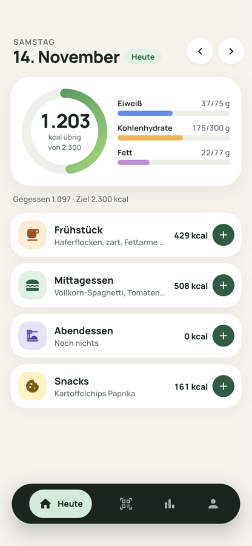
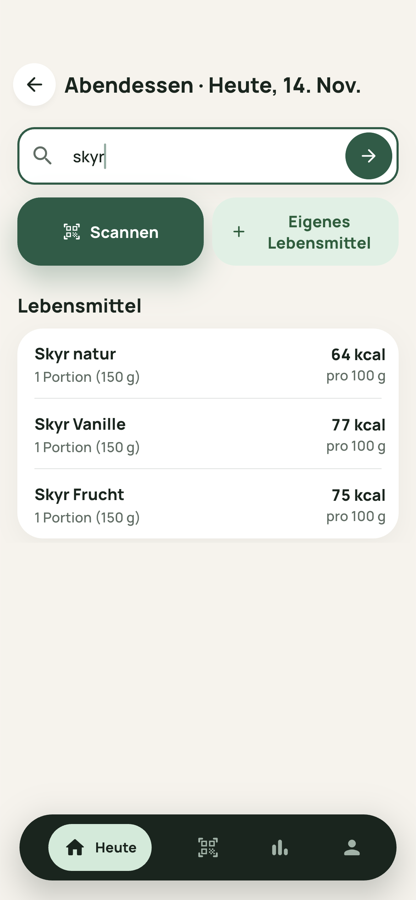
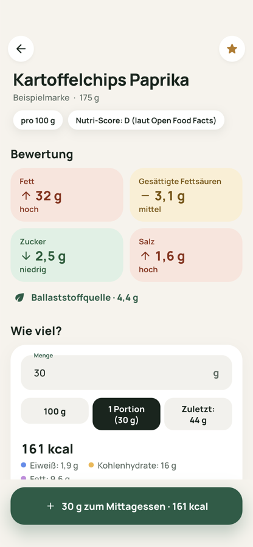
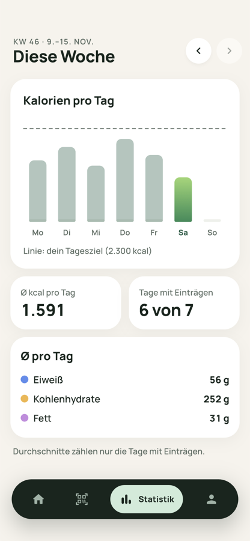

# Food Tracker

<!-- Working title. The final app name is chosen before the first store release. -->

**An open-source food diary for iPhone and Android that keeps your data on your phone.**
Count calories and macros, find everyday foods by their normal name, scan a barcode to see in plain
words how much fat, sugar and salt a product contains, and set a daily goal with a transparent
calculator. No account, no ads, no tracking.

> Status: early development (version 0.1). Not yet in the App Store or on Google Play.

<p>
  
  
  
  
</p>

## Features

- **Today:** a calorie ring (left of your goal – or of the 2,000 kcal reference intake while you have no
  goal), protein / carbs / fat bars and your meals. Going over your goal is shown neutrally – no red, no guilt.
- **Simple search:** type „Skyr“ and get „Skyr natur“, „Skyr Vanille“, „Skyr Frucht“ – a curated list of
  about 400 everyday foods with normal names, found while you type, even offline. Brand products sold in
  Germany follow directly below.
- **Barcode scan:** EAN/UPC barcodes are looked up at [Open Food Facts](https://world.openfoodfacts.org) and
  cached on the device.
- **Plain-language rating:** fat, saturates, sugars and salt are rated low / medium / high per 100 g (or
  100 ml for drinks) with the UK front-of-pack thresholds – always icon + word, never colour alone. Fibre
  and protein earn plus points. The Nutri-Score is shown as plain text when Open Food Facts has one. There is
  deliberately **no single overall score**.
- **Own foods, favourites and recently eaten** for logging in a few taps.
- **Goals:** estimate your daily need (Mifflin-St Jeor × activity level) or enter a goal yourself. The
  calculator never suggests less than max(1,200 kcal, your basal metabolic rate).
- **Week statistics**, **your own meals** (rename, add, hide, reorder), German and English, light and dark.

## Privacy

Everything you enter stays in a database on your device. The app has no account, no analytics, no ads and
no tracking. The only network requests are product look-ups and searches at Open Food Facts, sent with the
app name and version. Deleting all data is one button in the profile.

## Health note

The rating and the calculator are guidance based on public reference values, not medical advice. If you are
ill, pregnant, breastfeeding or unsure, talk to a doctor or a registered dietitian. If food or weight weighs
heavily on you, the German BIÖG eating-disorder helpline is 0221 892031
([essstoerungen.bioeg.de](https://essstoerungen.bioeg.de)).

## Data sources and licences

| Data | Source | Licence |
|---|---|---|
| Products (search, barcode) | © Open Food Facts contributors, [openfoodfacts.org](https://world.openfoodfacts.org) | [ODbL](https://opendatacommons.org/licenses/odbl/1-0/), contents [DbCL](https://opendatacommons.org/licenses/dbcl/1-0/), photos [CC BY-SA](https://creativecommons.org/licenses/by-sa/3.0/) |
| Basic foods (`assets/data/bls_4_0.tsv`) | Max Rubner-Institut (2025): Bundeslebensmittelschlüssel (BLS), Version 4.0. DOI [10.25826/Data20251217-134202-0](https://doi.org/10.25826/Data20251217-134202-0) | [CC BY 4.0](https://creativecommons.org/licenses/by/4.0/) |
| Simple foods, BLS values (`simple_foods_bls.tsv`) | derived from the BLS 4.0 | CC BY 4.0 |
| Simple foods, averages (`simple_foods_off.tsv`) | medians of German Open Food Facts products | ODbL |

Details, including exactly what was changed: [`assets/data/README.md`](assets/data/README.md). Open Food
Facts values are maintained by volunteers and can be incomplete or wrong – please correct them on
openfoodfacts.org when you find a mistake. The app's **source code** is released under the
[MIT licence](LICENSE); the bundled **data** keeps its own licences above. The Manrope font is under the
SIL Open Font License (`assets/fonts/Manrope-OFL.txt`).

## Build it yourself

Requirements: Flutter **3.47.0** (stable), Xcode for iOS, Android SDK + JDK 17 for Android.

```sh
git clone https://github.com/mr-dzzs21/food-tracker.git
cd food-tracker
flutter pub get          # also generates the translations (lib/l10n)
flutter run              # on a simulator, emulator or device
```

After changing a table in `lib/data/database.dart`, regenerate the database code (and add a migration):

```sh
dart run build_runner build
```

Checks – the same ones CI runs on every push:

```sh
dart format --output=none --set-exit-if-changed lib test integration_test test_driver
flutter analyze
flutter test
```

Screenshots of every screen on a running simulator (offline, with example data):

```sh
xcrun simctl privacy booted grant camera com.diyarkaymaz.foodTracker   # iOS simulator only
flutter drive --driver=test_driver/integration_test.dart \
  --target=integration_test/app_screenshots_test.dart
```

The camera does not work in the iOS simulator; use the text search there.

## Project structure

```
lib/
  main.dart, app.dart, router.dart   start, theme/language, navigation (4 tabs)
  core/                              clock, number formatting, errors, theme, shared widgets
  data/                              drift database (+ migrations), settings
  features/
    products/   search (simple foods, BLS, Open Food Facts), barcode checks, health rating,
                product page, own foods
    diary/      diary data, Today screen, add-food flow
    scan/       scanner, text search page
    goals/      calculator, goal screen, reference intakes
    stats/      week statistics
    profile/    profile, settings, meals, about
  l10n/                              German + English texts (ARB files)
assets/data/                         bundled food lists (see their README)
tool/                                scripts that build the bundled food lists
test/                                unit and widget tests (mirrors lib/)
integration_test/                    screenshot run on a simulator or device
```

More: [docs/ARCHITECTURE.md](docs/ARCHITECTURE.md). A German beginner tour of the code:
[docs/RUNDGANG.md](docs/RUNDGANG.md).

## Before the first store release

- [ ] **Nutri-Score:** the app shows the grade as plain text. Before publishing, ask RAL (the German licence
      partner of Santé publique France, nutri-score@ral.de) for permission – or remove it.
- [ ] Fill in the Open Food Facts API usage form and decide on a contact for the User-Agent.
- [ ] Final app name (check it is free), app icon, splash screen.
- [ ] Localised iOS camera permission text (German `InfoPlist.strings`).
- [ ] Privacy policy page; App Store privacy label / Play data-safety form.
- [ ] Re-check the helpline number.

## Contributing

Issues and pull requests are welcome. Please run the checks above before opening a pull request.
